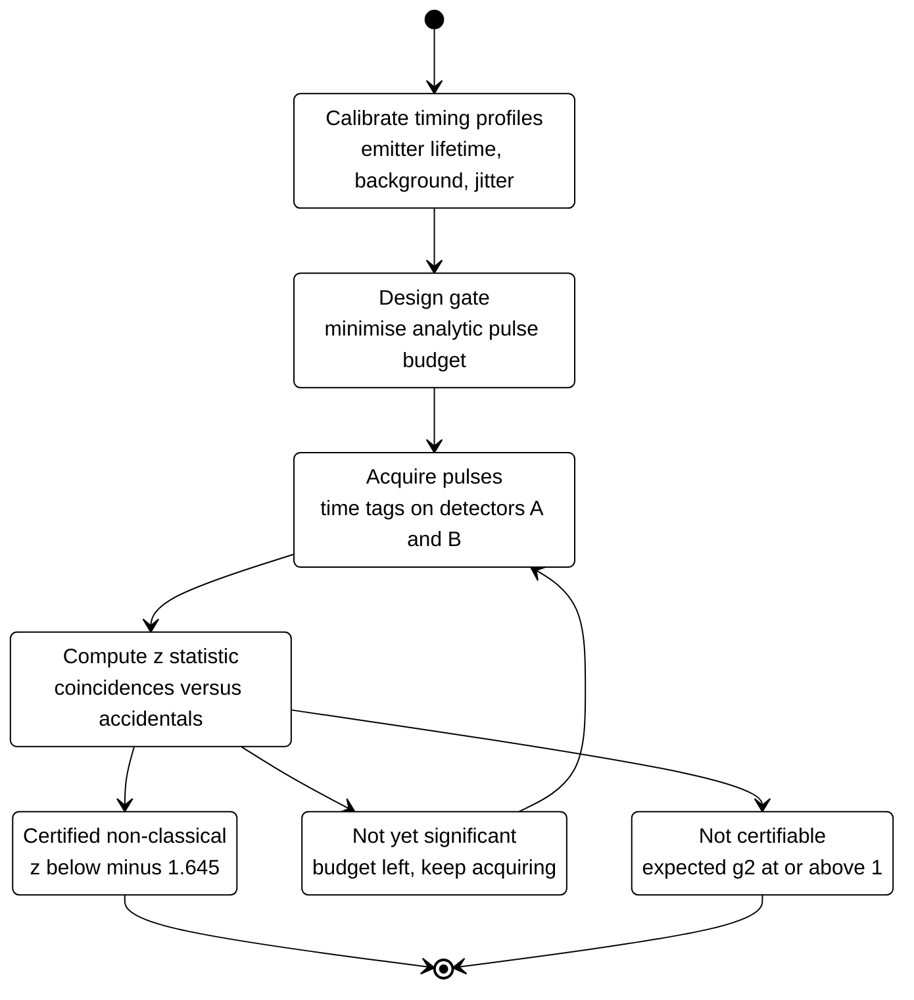
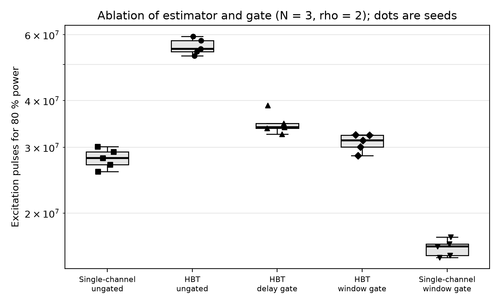
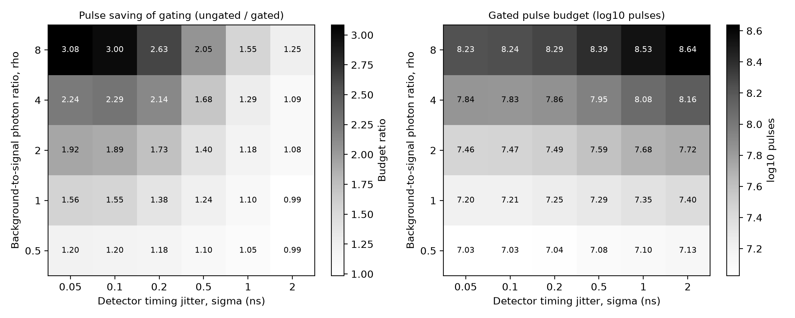
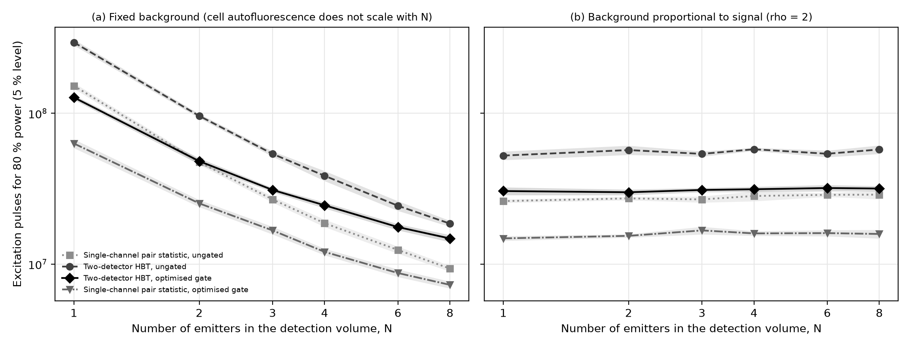
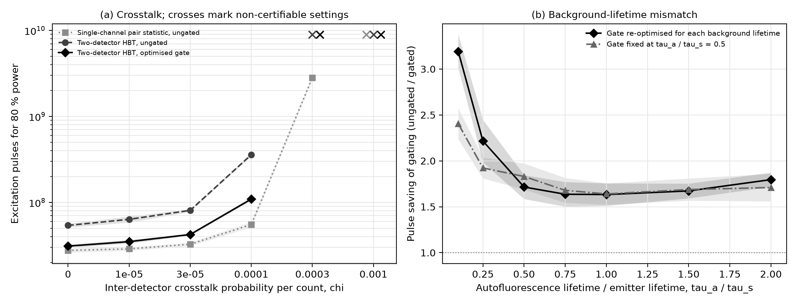
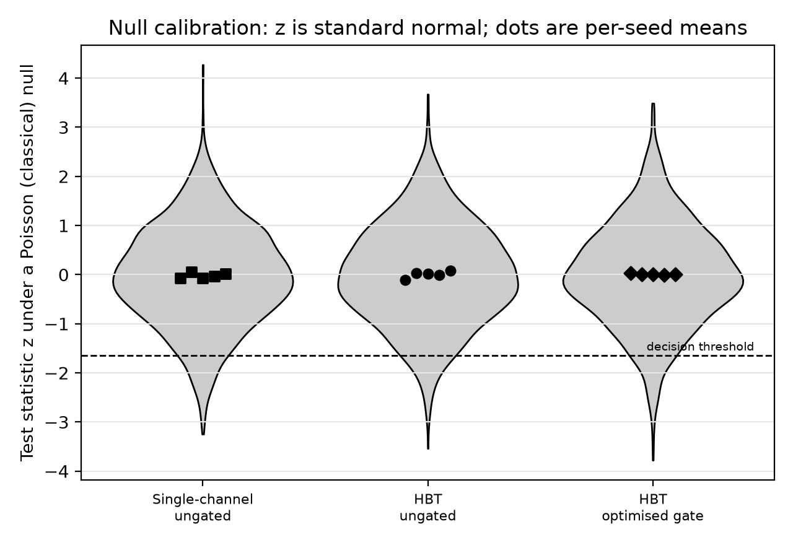
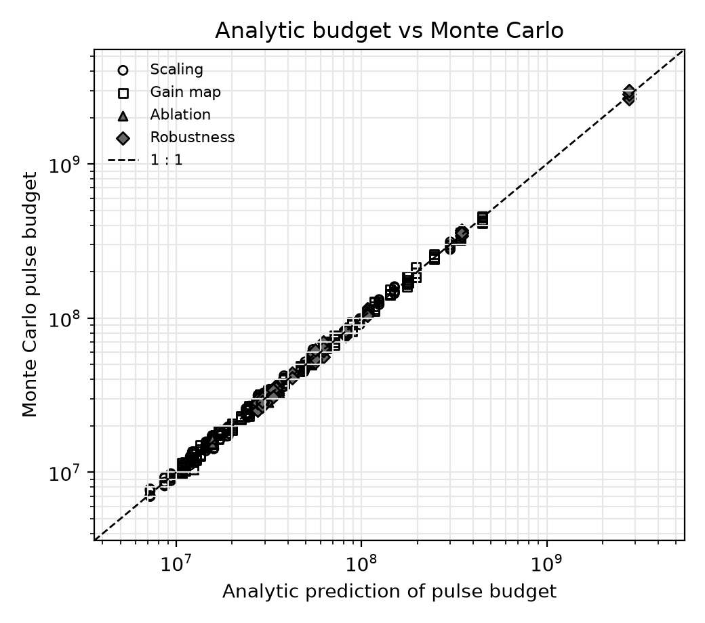

# Time-Gated Photon-Correlation Budget for Certifying Non-Classical Light from Emitter Ensembles

[](LICENSE)
[](pyproject.toml)
[](https://github.com/pradeepdegalaroyal/time-gated-g2-photon-budget-emitter-ensembles/actions/workflows/ci.yml)

**Research question.** When a few fluorescent emitters (for example proteins in a living cell) share one detection volume and the cell adds background light, how many excitation pulses are needed to certify that the light is non-classical, and how much of that budget can arrival-time gating win back?

**Answer in one line.** In this simulation, an optimised gate cuts the pulse budget of the two-detector Hanbury Brown–Twiss (HBT) test by 1.73 ± 0.12 at nominal settings (3.09e+07 ± 1.66e+06 versus 5.58e+07 ± 2.79e+06 pulses), up to 3.08 ± 0.09 at a background-to-signal ratio of 8, but the real wall is inter-detector crosstalk above about 1.7e-04 per count, which no gate removes.

## Abstract

We build an exact, validated pulse-budget model for certifying sub-Poissonian light from N independent pulsed emitters with Poissonian background, finite detector timing jitter and inter-detector crosstalk, and use it to compare a single-channel pair statistic, the ungated two-detector HBT test, and an arrival-time-gated HBT test. Monte Carlo experiments over five seeds agree with the analytic budget (median ratio 1.000 over 480 settings), keep the false-alarm rate at its nominal 5 % level, and show that gating helps when the background is prompt or flat in time but not when it shares the emitter's time profile. Everything is a simulation with assumed timing parameters; no quantum advantage or experimental claim is made.

## Motivation

Photon-correlation measurements of fluorescent emitters in living matter are limited by three practical facts. Several emitters sit in the detection volume, which dilutes the antibunching dip of the second-order correlation function at zero delay, g(2)(0), to 1 − 1/N for N ideal single-photon emitters. Cells add background light. Pixelated picosecond-class detectors have finite jitter and some crosstalk. Because fluorescent proteins bleach, the number of excitation pulses is the scarce resource, so a planning tool must say *how many pulses are enough* and *when no number is enough*.

## Research gap

The supplied literature (nine Scopus papers, four recent and five adjacent) treats related ingredients separately: photon-correlation records of macroscopic quantum jumps (Mavrogordatos, 2027, Digital Object Identifier (DOI) 10.1016/j.optcom.2026.133903), picosecond pixelated photodetector performance (Azmoun et al., 2027, DOI 10.1016/j.nima.2026.172216), entanglement estimates with rigorous bounds (Masajada et al., 2027, DOI 10.1016/j.cpc.2026.110479), and chiral single-photon emission that has mostly been studied at the ensemble level, with individual emitters scarce (Chen et al., 2026, DOI 10.1016/j.nanoen.2026.112511). None gives the pulse budget of a finite-sample non-classicality test with several emitters, background and detector imperfections. The full related-work table is in [`docs/RESEARCH_GAP.md`](docs/RESEARCH_GAP.md); the brief contained no landmark or review role, so the baseline tests are standard practice rather than cited papers.

## What is new here

* An **exact per-pulse state model** (binomial signal, Poisson background, beam-splitter routing, crosstalk) from which the 80 %-power pulse budget of any gate follows analytically; it is validated against Monte Carlo and against a photon-level time-tag simulation.
* A **gate designed by minimising that budget**, with the ungated window always a candidate, so the benefit and the cost of gating are measured rather than assumed.
* A **crosstalk threshold** at which the expected statistic crosses 1 (certification impossible at any budget), and a negative control where gating gives no gain.

## Hypotheses

* H1: gating cuts the budget by at least 1.5 for background-to-signal ratio rho ≥ 2 and jitter sigma ≤ 0.2 ns. **Supported** (1.73–3.08).
* H2: the gain is at most 1.1 for a background that has the emitter's own time profile, and when sigma is comparable to the lifetime at low rho. **Supported** (control 0.97 ± 0.05; 0.99–1.08 at sigma = 2 ns for rho ≤ 2).
* H3: crosstalk above chi* of order q / (4 (1 + rho)) makes certification impossible. **Supported at the nominal point** (measured 1.67e-04; the expression gives 2e-03 / 12 = 1.67e-04; not swept in q).
* H4: with a fixed cell background the budget falls with N; with a signal-proportional background it is flat. **Supported** (log-log slopes −1.03 to −1.33 versus +0.03 to +0.05).

The thresholds were set after a pilot run of the smoke configuration (see [`docs/RESEARCH_GAP.md`](docs/RESEARCH_GAP.md)).

## Method



Legend: HBT = Hanbury Brown–Twiss two-detector layout; g2 = second-order correlation function at zero delay; z = test statistic normalised by its standard error under a classical (Poisson) null. The module names are `timing` (arrival-time profiles), `statemodel` (exact photon-count distribution), `gate` (gate design), `certify` (Monte Carlo test and budget), `timetag` (photon-level validation) and `studies` (experiments).

**Model.** A 40 MHz pulsed laser excites N emitters; each gives at most one detected photon per pulse with probability q = 0.002. Signal photons arrive with a 3.0 ns exponential decay convolved with a Gaussian detector response of width sigma (0.2 ns nominal). Background photons are Poisson with mean rho·N·q per pulse (rho = 2 nominal), a mixture of prompt (0.4), autofluorescence with 1.5 ns decay (0.4) and flat (0.2) components. A 50/50 beam splitter feeds detectors A and B; crosstalk adds a spurious count on the other detector with probability chi.

**Estimators.** (i) Single-channel pair statistic (classical-statistics baseline; needs photon-number resolution), (ii) ungated two-detector HBT (standard quantum-optics baseline), (iii) gated HBT (proposed). The test certifies non-classicality when z < −1.645 (5 % one-sided level). The primary metric is the number of pulses for 80 % power. Full details: [`docs/METHOD.md`](docs/METHOD.md).

## Results

All numbers are mean ± standard deviation over five seeds and are copied from [`results/tables.md`](results/tables.md) (generated from the raw files in `results/`). Acquisition times assume the 40 MHz repetition rate.

### Ablation at nominal settings (N = 3, rho = 2)

| Method | Gate (ns) | Expected g2 | Pulses for 80 % power |
|---|---|---|---|
| Single-channel pair statistic, ungated | [-1.00, 24.00] | 0.9630 | 2.80e+07 ± 1.70e+06 |
| Two-detector HBT, ungated | [-1.00, 24.00] | 0.9630 | 5.58e+07 ± 2.79e+06 |
| Two-detector HBT, delay-only gate | [0.25, 24.00] | 0.9338 | 3.48e+07 ± 2.41e+06 |
| Two-detector HBT, optimised gate | [0.25, 12.50] | 0.9215 | 3.09e+07 ± 1.66e+06 |
| Single-channel pair statistic, optimised gate | [0.25, 12.50] | 0.9215 | 1.62e+07 ± 8.39e+05 |

The optimised HBT gate keeps 0.903 of the signal and 0.479 of the background. In time, 3.09e+07 pulses are 0.77 s and 5.58e+07 pulses are 1.4 s.



*Takeaway: the arrival-time gate and the choice of pair statistic each remove a large share of the budget, and they combine.*

### Gating gain over background and jitter



*Takeaway: gating pays off for strong background and sub-0.5 ns jitter (gain 1.73 ± 0.12 at rho = 2, sigma = 0.2 ns; 3.08 ± 0.09 at rho = 8, sigma = 0.05 ns) and gives nothing at rho ≤ 1 with 2 ns jitter (0.99 ± 0.06 and 0.99 ± 0.08).* Cell values with standard deviations are in [`results/tables.md`](results/tables.md).

### Scaling with emitter number

With a fixed cell background the gated HBT budget falls from 1.27e+08 ± 4.53e+06 pulses at N = 1 to 1.48e+07 ± 7.97e+05 at N = 8 (log-log slope −1.03); with a signal-proportional background it stays near 3.1e+07 (slope +0.03).



*Takeaway: the 1 − 1/N dilution of the dip is paid back by the N² growth of the pair rate, so more emitters make certification cheaper in pulses, provided the background does not grow with them.*

### Robustness: crosstalk and background lifetime

| Crosstalk chi | Single-channel, ungated | HBT, ungated | HBT, optimised gate |
|---|---|---|---|
| 0 | 2.76e+07 ± 1.66e+06 | 5.39e+07 ± 2.71e+06 | 3.10e+07 ± 1.29e+06 |
| 1e-05 | 2.88e+07 ± 1.33e+06 | 6.35e+07 ± 5.09e+06 | 3.49e+07 ± 1.65e+06 |
| 3e-05 | 3.26e+07 ± 1.48e+06 | 8.07e+07 ± 3.13e+06 | 4.23e+07 ± 1.16e+06 |
| 0.0001 | 5.53e+07 ± 3.92e+06 | 3.58e+08 ± 1.12e+07 | 1.09e+08 ± 4.52e+06 |
| 0.0003 | 2.82e+09 ± 1.61e+08 | not certifiable | not certifiable |
| 0.001 | not certifiable | not certifiable | not certifiable |

The crosstalk threshold chi* (expected g2 reaches 1) is 1.67e-04 for the ungated HBT test, 2.19e-04 for the gated test and 3.33e-04 for the single-channel statistic. When the gate is fixed at the tau_a / tau_s = 0.5 design instead of being re-optimised, the gain at tau_a / tau_s = 0.1 drops from 3.19 ± 0.18 to 2.40 ± 0.17; at ratios of 0.75 and above the two agree within the seed spread. A negative control (background with the emitter's own profile) gives 0.97 ± 0.05.



*Takeaway: a crosstalk of a few 1e-04 per count ends certification at the nominal detection probability, whatever the gate; gating mainly needs prompt or flat background to act on.*

### Detection probability, validity and model checks

Pulses scale as q to the power −2.00 (HBT, optimised gate): 1.28e+08 ± 4.89e+06 at q = 0.001 and 3.18e+05 ± 7.20e+03 at q = 0.02. The type-I error under a Poisson null is 0.044–0.051 across estimators and accidental-pair levels (nominal 0.05); see `results/null_calibration.csv` and the figure below. A photon-level time-tag simulation reproduces the analytic g2 (for example 0.9220 ± 0.0135 versus 0.9215 for the optimised gate; 1.2728 ± 0.0182 versus 1.2727 with 1 % crosstalk), and the Monte Carlo budget matches the analytic budget with a 5th–95th percentile ratio of 0.926–1.093.



*Takeaway: the test statistic is standard normal under a classical null, so the false-alarm rate is controlled.*



*Takeaway: the analytic pulse budget can be used for fast design sweeps.*

## Discussion

Gating is a real but moderate lever here: 1.73 ± 0.12 at nominal settings, growing with the background. Its benefit comes from removing prompt and flat background, not from lifetime contrast: with a background that has the emitter's own profile there is no gain (0.97 ± 0.05), and with an autofluorescence lifetime equal to the emitter's the mixed background still gives 1.63 ± 0.12 because its prompt and flat parts remain. Two results are less comfortable. First, the single-channel pair statistic needs half the pulses of the two-detector HBT test (2.80e+07 versus 5.58e+07) because it uses all pair types, but it requires photon-number resolution and the comparison assumes ideal resolution. Second, crosstalk of order q / (4 (1 + rho)) per count removes the signal entirely; the gate raises the tolerance by only about 30 % (2.19e-04 versus 1.67e-04). The strongest lever is the per-emitter detection probability q: budgets scale as q to the power −2, so collection and excitation efficiency (for instance through a cavity) matter more than any gate.

## Limitations

* Independent emitters with Bernoulli emission per pulse; no photobleaching, blinking, afterpulsing, dead time or emitter interactions. The pulse count is a proxy for the bleaching budget, not a model of it.
* All timing parameters, background composition and q are assumptions; the study is a design tool, not a measurement. No real data were used.
* The gate is designed with known profiles (oracle calibration); a fixed gate loses part of the gain when the background lifetime is much shorter than assumed.
* Crosstalk is instantaneous and proportional to counts, and the gate design ignores it; a coincidence-delay veto at pair level is not modelled.
* The expression for chi* was checked only at the nominal q.
* At most eight emitters and one detection volume; the hypothesis thresholds were set after a pilot run.

## Future work

On a real platform with pulsed excitation, single-photon detectors and a tunable microcavity, the next steps are to fit the emitter lifetime and background profile from measured decay histograms before designing the gate, to add a bleaching model that lets the emitter number decay during acquisition, to replace the per-count crosstalk by a measured pixel-pair crosstalk matrix with a coincidence-delay veto, and to let the cavity change both q and the lifetime so the budget can be optimised over cavity detuning. The same budget model applies to single emitters and to other detectors with photon-number resolution.

## Related work by the author

* [blinking-aware-g2-certification-photon-source](https://github.com/pradeepdegalaroyal/blinking-aware-g2-certification-photon-source): g2(0) certification of a single pulsed source with a blinking envelope; this project instead treats several emitters, background gating and crosstalk.
* [photonic-mesh-characterisation-photon-budget](https://github.com/pradeepdegalaroyal/photonic-mesh-characterisation-photon-budget): photon-budget thinking for photonic circuit characterisation.

## Reproducibility

```bash
pip install -r requirements.txt
pip install -e .
pytest -q                           # 8 tests, about 2 s
python experiments/run_all.py       # all results and figures, about 20 s
python experiments/run_all.py --quick   # smoke run, a few seconds
```

Hardware used: Windows 11 laptop, 16 central processing unit (CPU) threads, no graphics processor needed; Python 3.11.9, numpy 2.2.6, scipy 1.17.1, pandas 2.3.3, matplotlib 3.11.1 (see `requirements.txt`). The full run took 19.5 s (`results/summary.json`). Seeds are fixed in `src/gatedg2/studies.py`.

## Project structure

```
src/gatedg2/        config, timing, statemodel, gate, certify, timetag, studies, report, plots
experiments/        run_all.py (one command reproduces everything)
tests/              fast pytest tests
docs/               RESEARCH_GAP.md, METHOD.md
results/            raw per-seed tables (comma-separated values), JavaScript Object Notation summaries, tables.md
figures/            fig1 to fig6 (200 dpi)
.github/workflows/  continuous integration
```

## Citation

```bibtex
@software{degala_time_gated_g2_photon_budget_2026,
  author  = {Degala, Chenchupradeep},
  title   = {Time-Gated Photon-Correlation Budget for Certifying Non-Classical Light from Emitter Ensembles},
  year    = {2026},
  version = {0.1.0},
  url     = {https://github.com/pradeepdegalaroyal/time-gated-g2-photon-budget-emitter-ensembles},
  license = {MIT}
}
```

Massachusetts Institute of Technology (MIT) license (`LICENSE`). Citation metadata is also in `CITATION.cff`.
